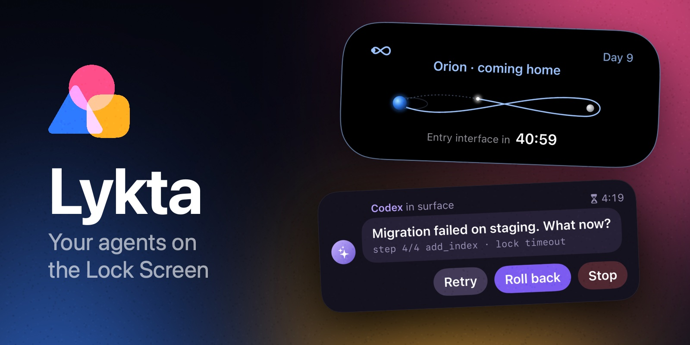
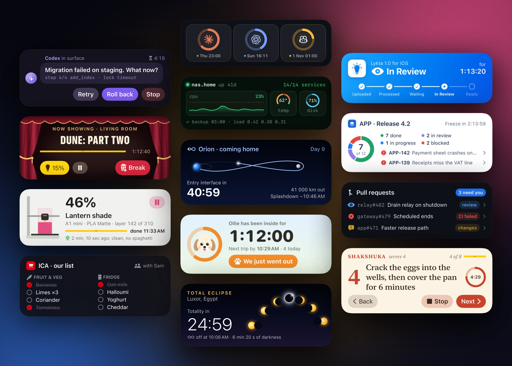

<p align="center">
  
</p>

<p align="center">
  <a href="https://testflight.apple.com/join/kDAjDvfD"></a>
</p>

Lykta lets AI agents put native Live Activities, widgets and notifications on
your iPhone. An agent sends a JSON layout to your Lykta gateway, and the phone
draws it with SwiftUI and keeps it current as the agent sends updates. Any
layout works without an app update, including buttons, toggles and links that
report back to the agent.

- **Live Activities** on the Lock Screen and in the Dynamic Island, for
  anything with an end, such as a build, a 3D print or a flight.
- **Widgets** on the Home Screen and Lock Screen, for status with no end, such
  as today's steps.
- **Notifications** that arrive like a message from a person, with the
  sender's name and picture, a sound of the agent's choosing and an image.

<a href="Gateway/Sources/LyktaGateway/Skill/examples"></a>

Every card above is one of the [example activities](Gateway/Sources/LyktaGateway/Skill/examples),
which an agent sends as JSON. A minimal activity and a notification look like
this:

```sh
lykta put activities/build <<'EOF'
{
  "title": "Build",
  "layout": {
    "lockScreen": {
      "hstack": [
        "Build",
        {"spacer": true},
        {"progress": "{{done}}", "style": "circular"}
      ],
      "modifiers": [{"padding": 16}]
    },
    "compactLeading": {"symbol": "hammer.fill"},
    "compactTrailing": "{{percent}}%",
    "minimal": {"progress": "{{done}}", "style": "circular"}
  },
  "data": {"done": 0.4, "percent": 40}
}
EOF

lykta put notifications/print-42-done <<'EOF'
{
  "sender": {"id": "printer", "name": "Printer"},
  "body": "Benchy finished in 42 min. Come get it!",
  "sound": true
}
EOF
```

## How it works

The app registers with your gateway, proving with App Attest that it is a
genuine copy, and shares its push-to-start token. When an agent starts an
activity, the gateway validates the layout with the same Swift code the widget
renders it with, then starts it through APNs and updates it over a broadcast
channel. Timers and progress run on the phone, so agents only send changes.
Widgets reload when the gateway sends a contentless widget push, at most every
20 minutes, and then fetch their content from the gateway with a credential
that can only read them. Notifications go out as alert pushes, and the app's notification extension
fetches the sender's picture, the sound and the image the agent uploaded, and
tells the gateway what it showed.

## Use it from an agent

In the app, Copy Agent Setup copies one command for the agent to run. It
installs `lykta`, a small command for sh with curl or for PowerShell that the
gateway serves with its agent skill, saves the gateway address and an agent
token in `~/.config/lykta`, says hello on the phone with a short Live Activity
and prints the [skill](Gateway/Sources/LyktaGateway/Skill/SKILL.md). On a new
install, the app waits for that hello to show that the agent is connected.
The agent then installs the skill in the folder it reads personal skills from,
such as `~/.claude/skills` or `~/.agents/skills`, with `lykta install`, so later
sessions know Lykta, and `lykta` keeps that copy and itself in step with the
gateway after each upgrade.
`lykta` sends a request in one call and answers once Apple has, so agents
spend their output on the activity rather than on HTTP plumbing. The skill
covers the API, its [layout reference](Gateway/Sources/LyktaGateway/Skill/references/layout.md)
covers every node, modifier and reusable layout part, its [widgets reference](Gateway/Sources/LyktaGateway/Skill/references/widgets.md)
covers Home Screen and Lock Screen widgets and their buttons and toggles, and its [notifications reference](Gateway/Sources/LyktaGateway/Skill/references/notifications.md)
covers senders, sounds and images. The [example notifications](Gateway/Sources/LyktaGateway/Skill/examples/notifications)
range from a CI run to a doorbell with its own chime, and the app shows every
example and sends any of them to your phone to try live.

## Self-host

You need an Apple Developer account, a machine that runs Docker, and an HTTPS
address your phone can reach. The [self-host guide](.agents/skills/self-host/SKILL.md)
walks through the APNs keys, the gateway container and the app build, and works
as a skill for coding agents.

## Development

```bash
just test   # core and gateway tests
just ios    # compile the app and its extensions
just evals  # fresh agents against a simulated phone
```

`Core` holds the layout language, `Gateway` serves the API and delivers
pushes, and `iOS` holds the app, its widgets, its notification extension and
the `Rendering` the app and widgets share.
CI and releases use the Xcode version in `.xcode-version` and locked package
resolutions. `python3 -m unittest discover -s scripts/tests -v` checks the
release tools without credentials.
See [AGENTS.md](AGENTS.md) for ownership and invariants and the
[architecture record](docs/architecture.md) for the design decisions.

## License and security

[PolyForm Shield 1.0.0](LICENSE): read, run, change, self-host and share
Lykta for any purpose except providing a product that competes with it. The
license covers the code, not the Lykta name or icon: a fork you distribute needs
its own. [PRIVACY.md](PRIVACY.md) describes what the gateway stores.

Report vulnerabilities privately through
[GitHub security advisories](../../security/advisories/new), not in a public issue.
