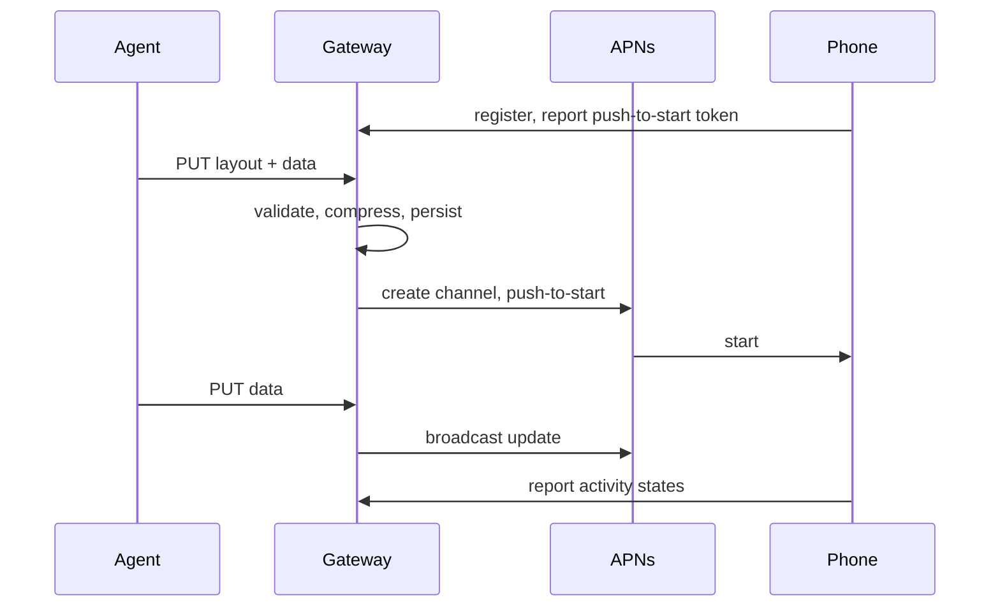

# Architecture

## Goals and constraints

- An agent shows a native Live Activity with one HTTP request, in nearly any
  layout ActivityKit can display, without an app update per layout.
- One person can self-host the gateway. Apple Push Notification service is the
  only external service.
- The codebase stays small: two Swift packages, Apple frameworks first, and
  third-party dependencies only from Apple's GitHub organization.

Non-goals for now: hosted multi-tenant service, interactive buttons, platforms
other than iPhone.

## Flow

## Decisions

**Layouts are data rendered by native views.** The language is a tree of
SwiftUI primitives and modifiers decoded by `LyktaCore`. `Rendering` maps each
node to its SwiftUI view. The widget and the app both compile it, so the app
shows each live activity exactly as the Lock Screen does. Fixed templates would
limit what agents can show, an extension cannot run downloaded code, and images
lose live timers and text quality. A new primitive needs an app update; until
then the phone shows the activity's title.

**One decoder validates and renders.** The gateway and the phone compile the
same `Layout` type, so a layout the gateway accepts renders on the phone, and
agents get errors with JSON paths when they send it. Budgets on bytes, nodes,
depth and modifiers keep rendering bounded.

**Push-to-start and broadcast channels.** The gateway starts an activity with
the phone's push-to-start token and updates it through a broadcast channel it
creates per activity, so the app never has to run to forward update tokens.
The cost is the Broadcast capability and channel cleanup: the gateway deletes a
channel five minutes after its activity ends and sweeps orphans at startup.

**The layout travels in the push.** `ContentState` carries the title and the
raw-deflated layout JSON; the phone decodes it once. The gateway checks the
real payload against the 4 KB APNs limit before accepting a request.

**One actor owns durable state.** `Store` owns the SQLite database; every
mutation is one transaction. Delivery claims jobs from rows, so a restart
resumes pending work. A start whose outcome is unknown becomes a live activity
with delivery `unknown` rather than being sent twice. An in-memory queue would
lose work on restart; an external queue would add infrastructure.

**Apple networking.** SwiftNIO serves HTTP/1.1 behind the operator's TLS proxy
on macOS and Linux. APNs requests use `URLSession`. On Linux it runs on
libcurl through FoundationNetworking, which negotiates the HTTP/2 that APNs
requires; the container image ships that libcurl.

**Two packages and a plain Xcode project.** `Core` has no dependencies and is
the only package the app links; `Gateway` adds SwiftNIO and, on Linux,
swift-crypto. The app uses Xcode's JSON project format directly instead of a
generator.

**Credentials.** Each phone gets a device secret and an agent token, both 256
random bits stored as SHA-256 hashes. Registration is open up to a configured
device limit; operators keep the gateway on a private network.

**Observability.** Every fact needed to debug a phone lands in the gateway's
`events` table, so nobody needs the phone or its logs.

- `Store` writes the gateway's events in the same transaction as the change
  they describe: puts, ends, syncs, failed requests, and each APNs attempt with
  the gateway's request ID, Apple's `apns-unique-id` for the Push Notifications
  Console delivery log, the outcome and the latency.
- The app records launches, scene phases, push-to-start tokens, authorization,
  each activity it observes with the content fingerprint it received, and
  MetricKit's crash, hang and daily metric reports. A bounded file queue holds
  them until a batch upload, so events from background wakes and offline
  periods arrive later. The widget extension has no network access, so the app
  observes rendered content through ActivityKit instead.
- Agents read their phone's events through `GET /v1/events`; operators read
  every phone with `lykta-gateway events`.
- Events hold IDs, states, fingerprints and errors, never tokens or activity
  content. They are kept 14 days, at most 8 MB per phone.

## Expensive to change

- The `ContentState` encoding and the `LyktaActivity` type name, which
  installed apps and pushes depend on.
- The meaning of existing layout keys, which agents' saved layouts rely on.
  Adding keys is cheap.
- The device API in `DeviceAPI.swift`, shared by installed apps and gateways.
