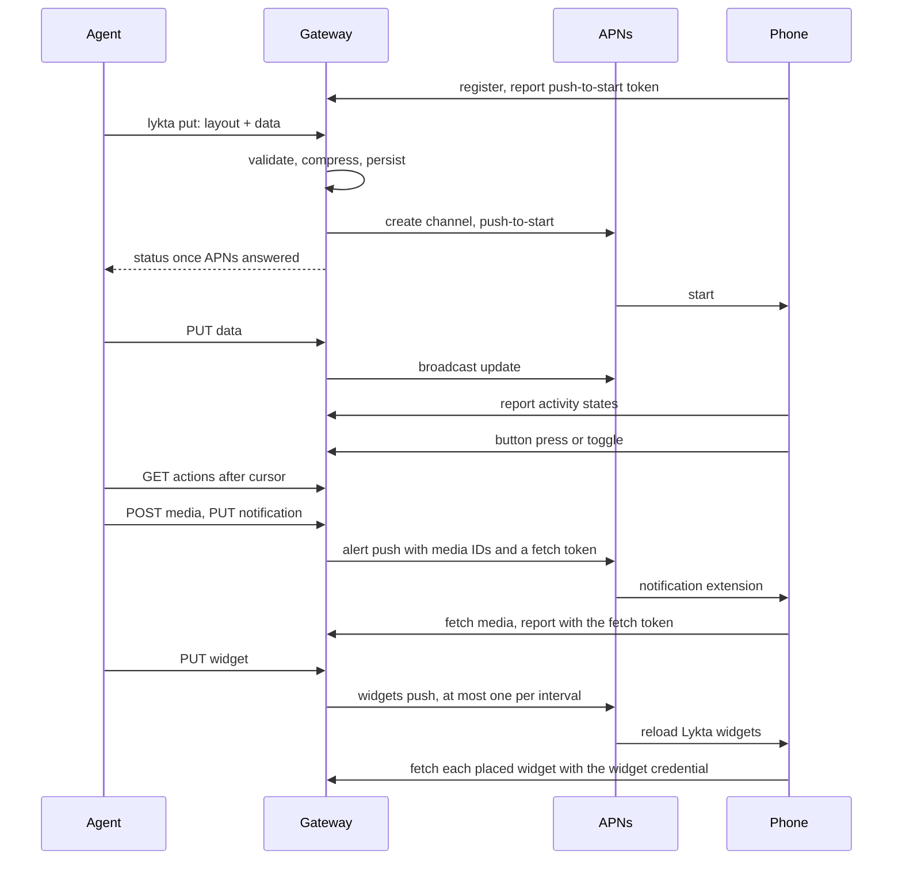

# Architecture

## Goals and constraints

- An agent shows a native Live Activity with one HTTP request, in nearly any
  layout ActivityKit can display, without an app update per layout.
- An agent tells the user about a moment with one HTTP request, as a
  notification from a sender it names, with the picture, sound and image the
  agent chooses; nothing is bundled into the app.
- An agent keeps a native widget on the Home Screen with one HTTP request, in
  the same layout language, and keeps it current by sending data; it stays
  until the agent deletes it.
- What an agent writes is the activity, widget or notification itself. Output tokens
  and tool calls are an agent's dominant cost and latency, so sending, timing
  and checking delivery take one command each, while the docs may be long.
- One person can self-host the gateway. Apple Push Notification service is the
  only external service.
- The codebase stays small: two Swift packages, Apple frameworks first, and
  third-party dependencies only from Apple's GitHub organization.

Non-goals for now: hosted multi-tenant service, platforms other than iPhone.

## Flow

## Decisions

**Layouts are data rendered by native views.** The language is a tree of
SwiftUI primitives and modifiers decoded by `LyktaCore`. `Rendering` maps each
node to its SwiftUI view. The widget and the app both compile it, so the app
shows each live activity with the Lock Screen's views, text sizes and height
limit. Only the app target defines `LYKTA_APP`, which swaps
`ProgressView(timerInterval:)`, a bar the app would redraw every frame, for a
`TimelineView` that redraws it a thousand times over its interval; the widget
keeps the bar the system animates. Fixed templates would limit what agents can show, an extension cannot
run downloaded code, and images lose live timers and text quality. A new
primitive needs an app update; until then the phone shows the activity's title.

**Artwork is SVG drawn natively.** Agents write SVG fluently, so the `svg`
node takes ordinary markup instead of a new drawing vocabulary. `LyktaCore`
parses a bounded subset, without external references, scripts or CSS, into
paths, paints and text, so the gateway rejects what the phone cannot draw;
`Rendering` draws it with `Canvas`. HTML and JavaScript stay out because an
extension cannot run web content or downloaded code, and pushes cannot carry
images.

**One decoder validates and renders.** The gateway and the phone compile the
same `Layout` type, so a layout the gateway accepts renders on the phone, and
agents get errors with JSON paths when they send it. Budgets on bytes, nodes,
depth and modifiers keep rendering bounded.

**Parts shorten authored layouts without changing the wire.** A template's
root `parts` maps names to nodes, and `use` copies one into any node position.
Core expands parts before filling, without data, so placeholders and `each`
variables have copy-paste scope at the use site; use-site modifiers append to
the copied modifiers. Nested parts are allowed, cycles and unused definitions
are refused, and expansion counts nodes as it copies, stopping at the layout
budget before an exponential graph can build its result. This reuses the
existing template filling and decoder rather than adding parameters or phone
features. Admission validates the authored template with errors mapped back to
parts, then stores only the expanded template. Data-only updates and taps refill
that stored template, so a 0.7.1 gateway can still read and update it after a
rollback; neither `parts` nor `use` needs a `Layout.introduced` row. The trade-off
is unchanged stored and push size: this saves agent output tokens, while
Deflate already compresses repeated nodes on the wire.

**Older phones get what they can draw.** The gateway deploys before each app
release, so it often runs a newer decoder than a phone. While decoding, `Core`
records every feature a layout uses (node kinds, keys, enum cases and value
forms such as a bare number) and looks each up by exact name in
`Layout.introduced`, the release that first drew it; the tests fail when the
skill uses a feature without a row. Every phone reports the newest row it was
compiled with, so self-built apps are judged by their decoder rather than their
marketing version; apps from before that report fall back to their version
string. The gateway gates the filled content of every PUT, including data-only
updates, and refuses with `app_update_required`, naming the feature, its JSON
path and both versions, so the agent can resend without it or ask the user to
update. A decoder version is learned only when the app runs, so the refusal asks
the user to update and open Lykta once. For anything the table still misses,
the phone reports whether it could read each content it observes, and the
activity's status shows that as `layoutReadable`; an update that arrives while
the app is not running goes unobserved until it next runs.

**The gallery bundles the skill's examples.** The Xcode project references the
skill's `examples` folder, so the app shows the same files the gateway serves,
drawn offline by `Rendering` before anything is sent. Fetching them from the
gateway would need a connection and a listing endpoint, and could show layouts
newer than the installed app draws. The Dynamic Island previews approximate the
system's regions and hold text to the sizes Xcode's previews draw: expanded
between large and xxxLarge like the Lock Screen, compact and minimal at large.
Timers ignore these limits in the app and follow its text size. Only a phone
shows the real presentation. Sending an example
is an ordinary PUT with the agent token to one activity named `example`, so
trying several updates one activity instead of spending the push-to-start
budget, and the gateway stays the only content writer.

**A started example asks to lock the phone, until the app is left while it asks.**
iOS keeps an app's own Live Activity out of the Dynamic Island and banners
while the app is in front, so starting an example seemed to do nothing. Once
ActivityKit reports the example active, `Model` shows `LockHint` over the app.
Going to the background clears it, and if it was showing, `Model` records in
`UserDefaults` that the hint did its job and never shows it again; Not Now
hides it only that time. The hint and the Start button wait for ActivityKit
rather than the PUT's answer, because the gateway accepting a start does not
prove the phone shows it, so the button's spinner lasts until the activity
shows, for at most 10 seconds. A TipKit tip could own the same rule, but one
flag in `Model` needs no datastore or extra observable state.

**The app shows each activity's times and ends it through the gateway.**
Each card on the home screen has a header with the activity's title, status
and last change, and a menu with Details, a sheet with its times and name, and
End Activity. The gateway returns the times in its answer to the device report
the app already sends, for the activities that report lists, so they cost no
request of their own and reach only the phone that shows them: `startedAt`,
`updatedAt`, which a start, an accepted change or a tap sets, and `endsAt`,
when the activity ended or will end: at the earlier of its `endAfter` and the
gateway's limit before iOS's, or after iOS's eight hours without one. Gateways
before 0.11.0 do not set `updatedAt`, so an activity one of them last changed
shows no change time, or after a rollback an earlier one, until it changes
again. An agent reading `GET /v1/activities` keeps the fields it had; no agent
needs these yet. End Activity sends `DELETE /v1/device/activities/{id}` with
the phone's secret, so it ends the activity the phone shows and never a newer
one an agent started under its name. The gateway ends it as with
`dismissAfter=0` and answers once that is committed, and the answer is the
gateway reporting the end, so the app removes the activity itself instead of
waiting for the end push, which may be late or fail, and its next report marks
the activity dismissed. The header shows Ending only while the request runs.
The app offers End only for an activity whose times the gateway sent, so with a
gateway before 0.11.0, which has neither the times nor the route, it offers
none.

**Push-to-start and broadcast channels.** The gateway starts an activity with
the phone's push-to-start token and updates it through a broadcast channel it
creates per activity, so the app never has to run to forward update tokens.
The cost is the Broadcast capability and channel cleanup: the gateway deletes a
channel five minutes after its activity ends and sweeps orphans at startup.

**Each token finds its APNs environment.** A token works only in the
environment of the build that obtained it, and a phone can move between Xcode,
TestFlight and App Store builds while staying registered. iOS keeps an
existing push-to-start token across such an update, so one phone can hold a
development push-to-start token and a production notification token. The
gateway sends a token to the environment the phone registered with until
APNs answers `BadDeviceToken`; then, if it has a key for the other
environment, it records the token's hash as moved and sends it there from
then on.
A second `BadDeviceToken` clears the token. Apple advises against retrying
`BadDeviceToken`, so each token gets one move. Because the gateway records
which token moved, a replacement token starts over, even one an older gateway
stored after a rollback. An activity's updates go to the
environment its channel was created in, because channels never cross
environments, and a start whose token moved gets a new channel.

**The layout travels in the push.** `ContentState` carries the title and the
layout JSON, canonical with sorted keys and unescaped slashes, raw-deflated;
the phone decodes it once. A phone that reports layout version 0.8.0 or later
gets the compact form: `~1`, then a JSON-safe base-92 text without quotes,
slashes or backslashes, of the legacy fingerprint's eight bytes, big-endian,
followed by the layout deflated with the preset dictionary
`WireDictionary.v1`. The gateway stores the legacy form and encodes each push
for its phone, so the fingerprint in events stays the same for both forms, and
a compact layout that fails to inflate still reports `layoutReadable: false`
under its fingerprint. `scripts/wire-dictionary` trained the 32 KiB dictionary
with zstd's COVER algorithm on the canonical filled examples and layout.md's
snippets at commit 53a182f; held out, it shrank the deflated layouts by 39%,
and both usage designs' content by 24% together with the denser text.
Released forms never change: a new dictionary or framing takes a new prefix,
and phones keep reading the old ones. Apple allows 4 KB twice:
for the APNs payload, and for the activity's attributes and content together.
Before accepting a start, update or tap, the gateway measures the push for the
activity's phase, the end push with the longest dismissal date, and the
attributes with the content, in the form the phone receives. Pushes are
measured as the previous release would send them, so a rollback can still
deliver and end everything it accepted; the attributes and content keep
Foundation's slash escaping, because iOS does not document how it counts them. The PUT response reports the larger push as
`payloadBytes`. A refusal names the limit that failed and estimates, with at
most 48 compressions in the phone's form, how many bytes the costliest JSON
paths take, counting identical copies together. Containers count
as well as long values, and a container whose cost one path inside it explains
gives way to that path. The estimates overlap, so the message says they do not
add up.

Release 0.8.0 admitted by the legacy form with escaped slashes, so 0.7.1 could
deliver all it accepted; from 0.9.0 admission measures each phone's form as
sent. After a rollback to 0.8.0, activities larger than its measure allows keep
delivering and can end, but updates and taps that keep them that large are
refused until 0.9.0 or later runs again. Only TestFlight and
development builds can downgrade a phone: pushes after its report use the
older form and its version's features, nothing is resent, and an activity it
can no longer read stays as it was until its next update or end, or until iOS
removes it. An activity admitted larger than the older form allows can no
longer update or end by push and stays until iOS removes it.

**Taps travel through the gateway.** An activity button or toggle runs a
`LiveActivityIntent` in the app, which posts the action to the gateway with the
device secret. The gateway applies a toggle itself: it flips the boolean at the
toggle's data path, raises the revision and pushes the new content, so the
switch stays right with no agent listening and the gateway remains the only
content writer. A button applies its declared changes the same way: `set`,
`add` and `now` read the data from before the press, and a press whose result
the layout cannot fill, or that would outgrow the push or the phone's decoder,
changes nothing. That covers steppers, resets and pause buttons without a
scripting language or an agent; anything richer stays with agents. A press
counts only for a control the current data shows, so a stale second tap on a
button an `if` has since hidden is refused. Buttons and toggles both join a
per-phone action log that agents read with `GET /v1/actions`, long-polling from
a cursor. The gateway never calls out: webhooks would need every agent to expose
an endpoint and would let a layout make the gateway request arbitrary URLs. An
agent that writes data a tap may have changed reads the activity and sends
`ifRevision`, which the gateway refuses with 409 if a tap landed in between. Actions are kept a day, at
most 1,000 per phone. Links open through the app's URL handler, so a layout can
reach any https or app URL without a gateway round trip.

**Widget taps share the action log.** From 0.14.0, widget buttons and toggles
run an AppIntent in the app and send the device action with a widget UUID.
`Action.Target` requires exactly one activity or widget. `Store` owns the
transaction that checks the current controls, applies effects, admits the
result through the same path as PUT, increments the widget revision when the
data changed, and writes the action and `widget.action` event. A tap raises no
push generation: WidgetKit reloads a widget once its tap's intent returns, and
the intent returns after the gateway committed, while a push would spend the
phone's 20-minute push interval and hold the agent's answer to the tap behind
it. The app, which iOS launches in the background for the tap, reloads every
Lykta widget only when another place shows the same widget, because that
reload counts against every placed widget's budget while the tapped widget's
own reload is free. Taps require an unlocked phone, as Live Activity taps do.
Hidden controls and invalid results change nothing. Agents read names under exactly one of
`activity` or `widget` in the existing log and cursor. A separate widget log
would make agents coordinate two cursors for the same kind of interaction.

`Schema.migrate` rebuilds `actions` to make `activity_id` nullable and add
`widget_id REFERENCES widgets(id) ON DELETE CASCADE`, with a CHECK requiring
exactly one target. It copies every row with its `seq` and preserves the
AUTOINCREMENT high-water mark even when the highest rows were pruned. Schema
version stays 1: the old gateway's explicit activity insert, activity join,
retention and cursor statements still work; its activity join omits widget
taps. No other table references actions. Tests execute those old statements
against the rebuilt table, including migration after pruning every action.
This keeps rollback readable without a separate shadow log or compatibility
writer. A rolled-back gateway refuses a widget tap with 400, because its
decoder knows only `activity`, and the reload after the tap reverts the
control. Changing those old statements or adding a foreign key to actions
requires revisiting the rebuild and rollback contract.

**Notifications arrive as messages from their sender.** The gateway sends an
alert push at priority 10 with the sender's name as the title, the body,
`sound: "default"` when the agent asked for a sound, `mutable-content`,
`thread-id` from `sender.id`, and a `lykta` object with the notification's
UUID, the sender ID, a fetch token and the IDs of its avatar, sound and
image. The `LyktaNotifications` extension uses the sender's avatar or draws
the sender's initials on a circle colored by `sender.id`, because iOS shows
the app icon rather than initials for a sender without an image. It
builds an `INPerson` with an app-specific handle and no contact suggestion
and an incoming `INSendMessageIntent` whose conversation is the sender ID,
donates it, waits for the donation to succeed as Apple's guide does, and
passes the result of `updating(from:)` on unchanged, so iOS shows the avatar
and name with the app icon as a badge. The Communication
Notifications capability on the app is all this needs, with no extension
entitlement and no SiriKit. If the donation or the intent fails, the
extension delivers the plain alert with its sound and image; if the extension runs out of time, iOS
delivers the original with the default sound. The push reads
correctly without the extension. The app asks for permission when the user
taps Copy Agent Setup, or Allow on the home screen for installs set up
earlier, registers for remote notifications, and reports the authorization,
the banner style and the token in its device report, or the reason iOS gave
for refusing one, which the gateway passes on in its `notifications_not_set_up`
answer and the app shows on its home screen. A phone whose report
lacks them runs an app without notifications, also after going back from a
newer one, so the gateway forgets its settings and token and answers
`app_update_required`.

**A notification is one event for a day.** Its name follows the activity
name rules and stays reserved until `expires`, a day after it was accepted;
the push's `apns-expiration` and the fetch token end then too. Within that
day the same request returns the notification before any readiness or
quota check, so an agent retries a lost response by repeating it, and a
different request under the name is a conflict. Phones take 60 an hour, and
the refusal carries `Retry-After`. States are `queued`, `sent`, `received`,
`failed` and `unknown`. A send whose APNs outcome is uncertain, or that was in
flight when the gateway stopped, becomes `unknown` and is never sent again;
429 and 5xx answers guarantee no delivery and are retried with backoff until
expiry, and `Unregistered`, or `BadDeviceToken` in both environments, clears
the phone's notification token and fails what waited for it. The extension's report sets `received`
and wins over an APNs outcome that completes after it; the first report wins.
Notifications never coalesce, unlike activity updates.

**A fetch token per send.** Claiming a notification for a send creates a
random fetch token, stores its hash and hands the plaintext only to that push.
It authorizes only `POST /v1/device/notifications/{uuid}/report` for that
notification until it expires, so the extension never needs the device
secret, which would mean sharing the Keychain item with it. The extension
reports to its own gateway, follows no redirect, and waits at most three
seconds for the answer before handing the notification to iOS, since iOS may
stop the extension once it has. A retried send gets a new token.

**Media is a resource of its phone.** `POST /v1/media` takes a raw WAV, PNG
or JPEG of at most 4 MiB, the listener's limit on that route alone, and
returns an opaque ID scoped to the uploading phone; a repeated file returns
its existing ID. The gateway reads the bytes, not the `Content-Type`: WAV
must hold linear PCM shorter than 30 seconds, the longest sound iOS plays, and
images at most 4096 pixels on a side. One format per kind keeps the validator
small and Linux-portable; agents convert with a single command. `Store` keeps
media as SQLite blobs, so backups, restores and rollbacks stay as they were,
and removes a file a day after its last upload or reference, which outlasts
any notification that names it, within 32 MiB per phone. A notification's
media references are checked, kind included, before it is queued. The fetch
token also authorizes `GET /v1/device/notifications/{uuid}/media/{id}` for
the media its notification names. Base64 or multipart notification bodies
were rejected because they put binary data in every request and lose reuse.

**The extension owns the phone's media cache.** It downloads what it lacks
within 20 seconds, all at once, and moves each file into place: sounds into
`Library/Sounds` in the app group's container, the only place outside the
bundle where `UNNotificationSound` finds a downloaded sound, avatars decoded
by ImageIO to 256 pixels into the group's caches, and the image into a
temporary file that becomes the notification's attachment. An extension
signed without the app group stops at its first notification rather than
dropping sounds and avatars unseen. One cache owner
in the extension process places every file and leases the ones each
notification needs until it is handed to iOS, so overlapping notifications
never evict each other's, and keeps sounds and avatars within 64 files and
64 MiB by removing the least recently used first. A download that finishes
after the deadline places nothing and removes what it staged. A file it cannot fetch leaves the default sound or the initials, and
the report says which. While the phone is unlocked, a Temporary banner stops a
sound when it slides away after about nine seconds; only the user can choose
Persistent banners, so the skill keeps sounds under eight seconds unless the
phone reports them. Live Activity pushes run no extension, so their alerts
keep the default sound.

**The extension prepares synchronously.** iOS calls the extension with a
content handler that is not `Sendable`, so Swift 6 cannot move it into a task
without silencing isolation, which Lykta does not do. The extension waits for
its downloads, its donation and its report with semaphores on the thread
iOS called it on; every wait is bounded, 20 seconds for media and 3 each for
the donation and the report, within the 30 iOS allows.

**A widget is a place, not an episode.** `/v1/widgets/{name}` sits beside
activities and notifications because its lifecycle differs: no alert, no end
and no 4 KB limit, and it stays until an agent deletes it. A layout names
widget families, such as `systemSmall`, instead of Live Activity
presentations; everything below the root is the same grammar, and one
`Presentation` table in `Core` decides where links and controls work. Each
widget has a UUID beside its name; a PUT after a DELETE creates a new id, so
a place that showed the old widget shows it as removed instead of silently
following a different widget. One widget kind, `Lykta`, is compiled into the
app, and the user picks an agent's widget for each place through its
`WidgetSelection` configuration intent, whose entity id is the widget's UUID.
A kind per agent widget would need an app update; placements that follow the
newest widget would let one new widget replace several places. The entity
query offers no default for the same reason: a new place asks the user to
choose, so creating a widget never changes what an existing place shows.

**A widget push only invalidates.** WidgetKit gives an install one widget push
token, and a push carries no content and reloads every Lykta widget. The
gateway therefore keeps a generation per phone: a change raises it only when a
place shows the changed widget or the phone has not yet reported its places,
and the delivery loop sends one push per phone when the generation is ahead of
the pushed one, at most once per `Store.widgetPushInterval`, 20 minutes. That
interval is Lykta's own throttle: WidgetKit's reload budget is dynamic and
Apple's to apply. A push with an unknown outcome counts against the interval
like an accepted one, because Apple may have taken it, and is retried once the
interval passes; it carries no content, so retrying it is safe. So does a push
a restart interrupted, and one whose token a report replaced while it was in
flight, because either may have reached Apple. Placing a
widget pushes nothing, because WidgetKit loads a new place itself, and a widget
changed while no place showed it has no generation, so its status stays
`pending` without `nextPush` until that load. Status derives `delivery` from
these rows instead of storing it.

**The widget extension fetches with a widget credential.** On a reload the
timeline provider asks `GET /v1/device/widgets/{id}` with the family, the
revision it holds and its layout version; the answer is the whole filled
widget, 204 when the revision is current, 410 `widget_deleted`, or the title
with the version it `requires`. The widget credential, created by the app with
the device secret and kept in the keychain under the app group, can only read
this phone's widgets and send their report, so the extension never holds the
device secret. Every fetch records its place, and its revision when the
answer is content the phone can draw in that size, which is the receipt agents
see as `fetched`. A phone's layout version is the one its latest report or fetch
states, so admission and status follow a downgrade: an agent's next change is
refused with `app_update_required`, and status shows `failed` while the phone
cannot draw the current revision. Only the provider, the entity query and the
push handler call the gateway, each with a 10-second timeout; views never
fetch.

**One owner caches widget answers.** `WidgetCache` keeps the last answer per
widget in the app group, under a file lock, so concurrent reloads cannot
overwrite a newer revision with an older one. A 410 leaves a fence no later
answer can lift, and a 401 empties the cache; a transient failure or a gateway older than widgets draws the cached content as
stale and retries in 15 minutes, then hourly. A timeline asks for its reload
at the stale time or after three hours, whichever comes first, and iOS decides
when it happens. A fetch names the cached revision only when that content
decodes, so an updated app replaces a cached `requires` answer. The cache
belongs to one widget credential, kept as its hash: an answer is recorded only
while the credential that fetched it is still the keychain's, and a cache
written for another credential counts as empty. A 401 does not fence the
credential, because a proxy in front of a self-hosted gateway can answer one
too; the next reload asks again. Reset deletes the credential and then the
cache, so nothing from before a Reset shows after it. A cache file that no
longer decodes, such as after a downgrade, counts as empty, and a failed write
loses only what the next fetch restores, because the gateway can rebuild the
cache. When the cache cannot be
locked or read, the provider still draws the gateway's answer, uncached, if
the credential that fetched it is still current. Gallery previews
draw cached content and never fetch, because a preview is not a place. The
cache keeps the 64 widgets used most recently.

**Places are reported, then proved by fetches.** The extension's push handler
sends the push token and the places WidgetKit reports; the app sends the same
report from `WidgetCenter.currentPushInfo` and `currentConfigurations()` each
time it becomes active, one at a time, which recovers a report the extension
could not send. Each report carries a `sequence` that the app and the
extension take from one counter in the app group, under the cache's file lock:
the larger of the last one plus one and the time in milliseconds. Each takes
its sequence before it reads the token and places it reports, so sequences
follow the order of what was observed, and a counter that cannot be read fails
the report instead of starting again below the gateway's fence. The gateway
ignores a report no newer than the last it applied, so a delayed one cannot
restore an old token or old places. The fence never expires, because only the
phone orders its reports. A reinstall erases the counter, so a phone whose
clock once ran ahead has its reports ignored until real time passes the last
one the gateway applied; resetting the fence on a new install instead would let
a delayed report from before an update restore stale places.

**Agents send with a script the gateway serves.** The skill's `scripts`
folder holds `lykta`, for POSIX sh with curl, and `lykta.ps1`, its twin for
PowerShell 5.1 and later, with the same commands, output and exit codes. Each
command is one request, or one per file, so an agent writes a path and its JSON
instead of HTTP code, and the token once at setup instead of in every request.
A compiled binary would need one build per platform in every release and in
every self-hosted image, or a download from GitHub, for no gain an agent
notices: sh and curl start in about 8 ms, against hundreds of milliseconds of
network and APNs and seconds of model time per call. The scripts stay readable
before they run and come from the same commit as the gateway that serves them.
Setup saves the URL and token in `~/.config/lykta` (`XDG_CONFIG_HOME` when
set), the token readable only by the user through mode 600, or on Windows an
access list for the user alone, and `LYKTA_URL` and `LYKTA_TOKEN`
take precedence. The references and examples are not cached: an agent reads
them once per task with `lykta docs`, and a cache would only save input. curl takes the token as an argument, so other
users of the same computer could see it while a request runs, as with the
curl commands the skill showed before; PowerShell keeps it in the process.
Only a refused connection is retried, for up to eight seconds while a gateway
restarts, because only it proves the request was never sent; after any other
failure of a PUT, `lykta` tells the agent to read the result before sending
again. On Windows, setup installs `lykta.cmd` in `~\.local\bin`, which runs the
script with the execution policy bypassed, because Windows blocks scripts by
default. cmd parses its arguments again, so in PowerShell an argument holding
`&` needs double quotes inside single quotes, as tested on Windows PowerShell
5.1; calling `powershell -File` directly would avoid cmd but cost some twenty
output tokens on every call.

**Agents install the skill, and `lykta` keeps it current.** Setup installs
`lykta` at `~/.local/bin/lykta`, or `~/.local/share/lykta/lykta.ps1` with
`lykta.cmd` on Windows, and asks the agent to run `lykta install DIR` with the
folder its harness reads personal skills from, such as `~/.claude/skills` or
`~/.agents/skills`. The agent knows its harness, so `lykta` has no per-client
code; `npx skills` and `gh skill` would need Node or gh, which no system ships.
An installed copy is SKILL.md alone, because agents read the references and
examples live, so every write is one file and one rename. Each file `lykta`
writes ends with a `lykta-skill` line naming the digest it came from. The line
marks the file as `lykta`'s, so `install` refuses a symlink or a folder
something else made, and it changes in the same rename as the content, so
concurrent `lykta` processes need no lock and a copy from an older gateway is
replaced on a later call. Every gateway answer carries `lykta-skill`, a SHA-256
over the skill's files. After a successful command has printed its result,
`lykta` compares the header with its own file and the copies recorded in
`~/.config/lykta/skills` and downloads those that differ, ten seconds at most
per file, without changing the command's exit status. Only answers from the
gateway setup saved count, so `LYKTA_URL` pointing at a test gateway writes
nothing. A gateway rollback rolls the copies back too; a gateway older than
0.15.0 sends no digest and leaves them as they are, and setup with a newer
`lykta` fails there with a pointer to the app's setup, which downloads that
gateway's own `lykta`. The registry is only appended to, so two installs at
once may record a folder twice, which only repeats a check, and a recorded
folder that is gone or no longer `lykta`'s is skipped. An install interrupted
before its SKILL.md arrived leaves an empty folder or a staging file, which
the next `install` clears.

**A PUT can wait for Apple.** `wait` on `PUT /v1/activities/{name}` and
`PUT /v1/notifications/{name}`, 0 to 25 seconds like `GET /v1/actions`, holds
the answer until the delivery loop has pushed that revision, the activity has
ended or a retry is scheduled, and `lykta put` sends 10. The answer then says
what Apple did, so agents no longer read the status after a PUT. `delivery`
describes the current revision: an update that has not been pushed reads
`pending`, not the previous revision's `accepted`. `now` sets data paths to the
gateway's clock plus an offset, as a button's `now` does but creating missing
paths, so agents need no clock or script to time an activity.

**One actor owns durable state.** `Store` owns the SQLite database; every
mutation is one transaction. Delivery claims jobs from rows, so a restart
resumes pending work. A start whose outcome is unknown becomes a live activity
with delivery `unknown` rather than being sent twice. An in-memory queue would
lose work on restart; an external queue would add infrastructure.

**Apple networking.** SwiftNIO serves HTTP/1.1 behind the operator's TLS proxy
on macOS and Linux. APNs requests use `URLSession`. On Linux it runs on
libcurl through FoundationNetworking, which negotiates the HTTP/2 that APNs
requires; the container image ships that libcurl.

**Two packages and a plain Xcode project.** `Core` has no dependencies and is
the only package the app links; `Gateway` adds SwiftNIO, swift-certificates
for App Attest and, on Linux, swift-crypto. The app's project in `iOS` uses Xcode's JSON project format directly
instead of a generator.

**Release admission owns credential access.** The public tag workflow rejects
invalid, lightweight, empty-note, older and off-main tags before a credentialed
job starts, then reuses CI on that exact commit. Building inside the same job
before its admission check would expose the later credentials to the earlier
code. CI and releases use one `.xcode-version` pin and locked package inputs.

**One exact upload per release job.** The serialized TestFlight job selects
max+1 across processed builds and pending uploads, injects it into every bundle
and disables export renumbering. Later jobs select that exact number. Each
version belongs to one immutable tag, so retries reuse the build or processing
upload Apple holds for that version and skip archiving, signing and uploading.
GitHub's attempt history fences any earlier attempt that started the separate
upload step: wait up to 15 minutes for Apple's list to show it, then fail rather
than upload again. A lost upload acknowledgement must not create a duplicate;
a failed entitlement check has not started the upload. The selector's command
substitution propagates a failure before any build-number output is written.
`entitlements.json` covers every app and extension, replacing the workflow's
inline bundle list; the export must retain their claims. The gateway still
deploys first and the phone upload waits for its reported version. A separate
upload path would need to coordinate build-number selection with this owner.

**Nested frameworks are signed before app bundles.** Sign embedded frameworks
deepest first before sealing app bundles, including code inside extensions.
Xcode's cloud export replaces those ad-hoc signatures; the export check requires
an Apple Distribution authority on each framework as well as the bundles'
entitlements. Checking only entitlements can miss an invalid framework signature.

**App Store preparation owns only its screenshots.** Upload reservations are
recorded before transfer, workers finish before cleanup, and cleanup touches
only the release's unplaced reservations and displaced images. A whole-library
sweep could delete another release's work. A version in review is left alone
with a notice; it does not fail the TestFlight release or withdraw that review.

**Credentials.** Each phone gets a device secret and an agent token, both 256
random bits stored as SHA-256 hashes. Registration needs proof, so a script
cannot use up the device limit. The app attests a new App Attest key over a
challenge the gateway signed less than five minutes earlier, and the gateway
checks the certificate chain against Apple's App Attest root, the challenge,
the key and the App ID built from its Team ID and bundle ID; each key registers
once. Simulators cannot attest, so an operator can instead create a one-time
invite valid for an hour with `lykta-gateway invite`. Someone with a real phone
and the genuine app can still register again by reinstalling, which the device
limit bounds.

**Observability.** Every fact needed to debug a phone lands in the gateway's
`events` table, so nobody needs the phone or its logs.

- `Store` writes the gateway's events in the same transaction as the change
  they describe: puts, ends, syncs, failed requests, and each APNs attempt with
  the gateway's request ID, Apple's `apns-unique-id` for the Push Notifications
  Console delivery log, the outcome and the latency.
- The app records launches, scene phases, push-to-start and notification
  tokens, Live Activity and notification authorization, the banner style,
  each activity it observes with the content fingerprint it received, and
  MetricKit's crash, hang and daily metric reports. A bounded file queue holds
  them until a batch upload, so events from background wakes and offline
  periods arrive later. The Live Activity makes no network requests, so the
  app observes rendered content through ActivityKit instead.
- Widgets add `widget.put`, `widget.delete`, `widget.credential`,
  `widget.placed`, `widget.action`, `push.widgets` and `widget.fetch`, the receipt of each
  place's load, with ids, revisions, generations and families.
- Agents read their phone's events through `GET /v1/events`; operators read
  every phone with `lykta-gateway events`.
- Notifications add `media.put`, `notification.put`, `push.notification`,
  `notification.media` for each file the extension fetched,
  `notification.received` from the extension's report, and
  `notification.unknown` and `notification.expired`; `device.sync` records the
  phone's notification authorization, banner style and token fingerprint.
- Events hold IDs, states, fingerprints and errors, never tokens, activity
  or notification content, or media. They are kept 14 days, at most 8 MB per phone.

## Expensive to change

- The `ContentState` encoding and the `LyktaActivity` type name, which
  installed apps and pushes depend on.
- The meaning of existing layout keys, which agents' saved layouts rely on.
  Adding keys is cheap.
- Released rows of `Layout.introduced`, which gate every phone that reported
  them, and the `layoutVersion` field and activity observations (with
  `layoutReadable` and the content fingerprint) that phones send.
- `GET /v1/version`, which the release workflow waits on before uploading an
  app build.
- The device API in `DeviceAPI.swift`, shared by installed apps and gateways,
  including the action report that installed apps send.
- The `GET /v1/actions` cursor and record format, which agents poll.
- The `lykta` commands, their output and exit codes and the setup in
  `~/.config/lykta`, which installed copies, agents' instructions and their
  saved scripts use, and the `wait` and `now` request fields. The installed
  `lykta` paths, the `lykta-skill` header and the line that ends each file
  `lykta` installs, which installed copies of `lykta` compare.
- The `/v1/notifications` and `/v1/media` contracts, their states, lifetimes,
  limits and error codes, the `lykta` payload object with its media IDs, and
  the report and media routes, which installed extensions use, and the
  notification fields of the device report.
- The app group `group.<bundle ID>` and its `Library/Sounds`, which installed
  extensions write and self-hosters configure.
- The widget kind `Lykta` and the `WidgetSelection` entity id, the widget's
  UUID, which placed widgets store; the `/v1/widgets` fields and delivery
  states, the widget presentation keys, and the device widget routes with
  their answers and codes, which installed extensions call.
- `sender.id` and what derives from it: Notification Center threads, Focus's
  allowed people and Siri's suggestions key on the handle and conversation.
