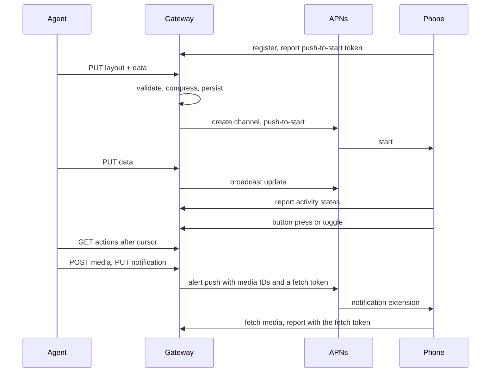

# Architecture

## Goals and constraints

- An agent shows a native Live Activity with one HTTP request, in nearly any
  layout ActivityKit can display, without an app update per layout.
- An agent tells the user about a moment with one HTTP request, as a
  notification from a sender it names, with the picture, sound and image the
  agent chooses; nothing is bundled into the app.
- One person can self-host the gateway. Apple Push Notification service is the
  only external service.
- The codebase stays small: two Swift packages, Apple frameworks first, and
  third-party dependencies only from Apple's GitHub organization.

Non-goals for now: hosted multi-tenant service, platforms other than iPhone.

## Flow

## Decisions

**Layouts are data rendered by native views.** The language is a tree of
SwiftUI primitives and modifiers decoded by `LyktaCore`. `Rendering` maps each
node to its SwiftUI view. The widget and the app both compile it, so the app
shows each live activity with the Lock Screen's views, text sizes and height
limit. Only the app target defines `LYKTA_APP`, which swaps
`ProgressView(timerInterval:)`, a bar the app would redraw every frame, for a
`TimelineView` that redraws it a thousand times over its interval; the widget
keeps the bar the system animates. Fixed templates would limit what agents can show, an extension cannot
run downloaded code, and images lose live timers and text quality. A new
primitive needs an app update; until then the phone shows the activity's title.

**Artwork is SVG drawn natively.** Agents write SVG fluently, so the `svg`
node takes ordinary markup instead of a new drawing vocabulary. `LyktaCore`
parses a bounded subset, without external references, scripts or CSS, into
paths, paints and text, so the gateway rejects what the phone cannot draw;
`Rendering` draws it with `Canvas`. HTML and JavaScript stay out because an
extension cannot run web content or downloaded code, and pushes cannot carry
images.

**One decoder validates and renders.** The gateway and the phone compile the
same `Layout` type, so a layout the gateway accepts renders on the phone, and
agents get errors with JSON paths when they send it. Budgets on bytes, nodes,
depth and modifiers keep rendering bounded.

**Older phones get what they can draw.** The gateway deploys before each app
release, so it often runs a newer decoder than a phone. While decoding, `Core`
records every feature a layout uses (node kinds, keys, enum cases and value
forms such as a bare number) and looks each up by exact name in
`Layout.introduced`, the release that first drew it; the tests fail when the
skill uses a feature without a row. Every phone reports the newest row it was
compiled with, so self-built apps are judged by their decoder rather than their
marketing version; apps from before that report fall back to their version
string. The gateway gates the filled content of every PUT, including data-only
updates, and refuses with `app_update_required`, naming the feature, its JSON
path and both versions, so the agent can resend without it or ask the user to
update. A decoder version is learned only when the app runs, so the refusal asks
the user to update and open Lykta once. For anything the table still misses,
the phone reports whether it could read each content it observes, and the
activity's status shows that as `layoutReadable`; an update that arrives while
the app is not running goes unobserved until it next runs.

**The gallery bundles the skill's examples.** The Xcode project references the
skill's `examples` folder, so the app shows the same files the gateway serves,
drawn offline by `Rendering` before anything is sent. Fetching them from the
gateway would need a connection and a listing endpoint, and could show layouts
newer than the installed app draws. The Dynamic Island previews approximate the
system's regions and hold text to the sizes Xcode's previews draw: expanded
between large and xxxLarge like the Lock Screen, compact and minimal at large.
Timers ignore these limits in the app and follow its text size. Only a phone
shows the real presentation. Sending an example
is an ordinary PUT with the agent token to one activity named `example`, so
trying several updates one activity instead of spending the push-to-start
budget, and the gateway stays the only content writer.

**Push-to-start and broadcast channels.** The gateway starts an activity with
the phone's push-to-start token and updates it through a broadcast channel it
creates per activity, so the app never has to run to forward update tokens.
The cost is the Broadcast capability and channel cleanup: the gateway deletes a
channel five minutes after its activity ends and sweeps orphans at startup.

**Each token finds its APNs environment.** A token works only in the
environment of the build that obtained it, and a phone can move between Xcode,
TestFlight and App Store builds while staying registered. iOS keeps an
existing push-to-start token across such an update, so one phone can hold a
development push-to-start token and a production notification token. The
gateway sends a token to the environment the phone registered with until
APNs answers `BadDeviceToken`; then, if it has a key for the other
environment, it records that token as moved and sends it there from then on.
A second `BadDeviceToken` clears the token. Apple advises against retrying
`BadDeviceToken`, so each token gets one move. Because the gateway records the
moved token itself, a replacement token starts over, even one an older gateway
stored after a rollback. An activity's updates go to the
environment its channel was created in, because channels never cross
environments, and a start whose token moved gets a new channel.

**The layout travels in the push.** `ContentState` carries the title and the
raw-deflated layout JSON; the phone decodes it once. The gateway checks the
real payload against the 4 KB APNs limit before accepting a request.

**Taps travel through the gateway.** A button or toggle runs a
`LiveActivityIntent` in the app, which posts the action to the gateway with the
device secret. The gateway applies a toggle itself: it flips the boolean at the
toggle's data path, raises the revision and pushes the new content, so the
switch stays right with no agent listening and the gateway remains the only
content writer. A button applies its declared changes the same way: `set`,
`add` and `now` read the data from before the press, and a press whose result
the layout cannot fill, or that would outgrow the push or the phone's decoder,
changes nothing. That covers steppers, resets and pause buttons without a
scripting language or an agent; anything richer stays with agents. A press
counts only for a control the current data shows, so a stale second tap on a
button an `if` has since hidden is refused. Buttons and toggles both join a
per-phone action log that agents read with `GET /v1/actions`, long-polling from
a cursor. The gateway never calls out: webhooks would need every agent to expose
an endpoint and would let a layout make the gateway request arbitrary URLs. An
agent that writes data a tap may have changed reads the activity and sends
`ifRevision`, which the gateway refuses with 409 if a tap landed in between. Actions are kept a day, at
most 1,000 per phone. Links open through the app's URL handler, so a layout can
reach any https or app URL without a gateway round trip.

**Notifications arrive as messages from their sender.** The gateway sends an
alert push at priority 10 with the sender's name as the title, the body,
`sound: "default"` when the agent asked for a sound, `mutable-content`,
`thread-id` from `sender.id`, and a `lykta` object with the notification's
UUID, the sender ID, a fetch token and the IDs of its avatar, sound and
image. The `LyktaNotifications` extension uses the sender's avatar or draws
the sender's initials on a circle colored by `sender.id`, because iOS shows
the app icon rather than initials for a sender without an image. It
builds an `INPerson` with an app-specific handle and no contact suggestion
and an incoming `INSendMessageIntent` whose conversation is the sender ID,
donates it, waits for the donation to succeed as Apple's guide does, and
passes the result of `updating(from:)` on unchanged, so iOS shows the avatar
and name with the app icon as a badge. The Communication
Notifications capability on the app is all this needs, with no extension
entitlement and no SiriKit. If the donation or the intent fails, the
extension delivers the plain alert with its sound and image; if the extension runs out of time, iOS
delivers the original with the default sound. The push reads
correctly without the extension. The app asks for permission when the user
taps Copy Agent Setup, or Allow on the home screen for installs set up
earlier, registers for remote notifications, and reports the authorization,
the banner style and the token in its device report, or the reason iOS gave
for refusing one, which the gateway passes on in its `notifications_not_set_up`
answer and the app shows on its home screen. A phone whose report
lacks them runs an app without notifications, also after going back from a
newer one, so the gateway forgets its settings and token and answers
`app_update_required`.

**A notification is one event for a day.** Its name follows the activity
name rules and stays reserved until `expires`, a day after it was accepted;
the push's `apns-expiration` and the fetch token end then too. Within that
day the same request returns the notification before any readiness or
quota check, so an agent retries a lost response by repeating it, and a
different request under the name is a conflict. Phones take 60 an hour, and
the refusal carries `Retry-After`. States are `queued`, `sent`, `received`,
`failed` and `unknown`. A send whose APNs outcome is uncertain, or that was in
flight when the gateway stopped, becomes `unknown` and is never sent again;
429 and 5xx answers guarantee no delivery and are retried with backoff until
expiry, and `Unregistered`, or `BadDeviceToken` in both environments, clears
the phone's notification token and fails what waited for it. The extension's report sets `received`
and wins over an APNs outcome that completes after it; the first report wins.
Notifications never coalesce, unlike activity updates.

**A fetch token per send.** Claiming a notification for a send creates a
random fetch token, stores its hash and hands the plaintext only to that push.
It authorizes only `POST /v1/device/notifications/{uuid}/report` for that
notification until it expires, so the extension never needs the device
secret, which would mean sharing the Keychain item with it. The extension
reports to its own gateway, follows no redirect, and waits at most three
seconds for the answer before handing the notification to iOS, since iOS may
stop the extension once it has. A retried send gets a new token.

**Media is a resource of its phone.** `POST /v1/media` takes a raw WAV, PNG
or JPEG of at most 4 MiB, the listener's limit on that route alone, and
returns an opaque ID scoped to the uploading phone; a repeated file returns
its existing ID. The gateway reads the bytes, not the `Content-Type`: WAV
must hold linear PCM shorter than 30 seconds, the longest sound iOS plays, and
images at most 4096 pixels on a side. One format per kind keeps the validator
small and Linux-portable; agents convert with a single command. `Store` keeps
media as SQLite blobs, so backups, restores and rollbacks stay as they were,
and removes a file a day after its last upload or reference, which outlasts
any notification that names it, within 32 MiB per phone. A notification's
media references are checked, kind included, before it is queued. The fetch
token also authorizes `GET /v1/device/notifications/{uuid}/media/{id}` for
the media its notification names. Base64 or multipart notification bodies
were rejected because they put binary data in every request and lose reuse.

**The extension owns the phone's media cache.** It downloads what it lacks
within 20 seconds, all at once, and moves each file into place: sounds into
`Library/Sounds` in the app group's container, the only place outside the
bundle where `UNNotificationSound` finds a downloaded sound, avatars decoded
by ImageIO to 256 pixels into the group's caches, and the image into a
temporary file that becomes the notification's attachment. An extension
signed without the app group stops at its first notification rather than
dropping sounds and avatars unseen. One cache owner
in the extension process places every file and leases the ones each
notification needs until it is handed to iOS, so overlapping notifications
never evict each other's, and keeps sounds and avatars within 64 files and
64 MiB by removing the least recently used first. A download that finishes
after the deadline places nothing and removes what it staged. A file it cannot fetch leaves the default sound or the initials, and
the report says which. While the phone is unlocked, a Temporary banner stops a
sound when it slides away after about nine seconds; only the user can choose
Persistent banners, so the skill keeps sounds under eight seconds unless the
phone reports them. Live Activity pushes run no extension, so their alerts
keep the default sound.

**The extension prepares synchronously.** iOS calls the extension with a
content handler that is not `Sendable`, so Swift 6 cannot move it into a task
without silencing isolation, which Lykta does not do. The extension waits for
its downloads, its donation and its report with semaphores on the thread
iOS called it on; every wait is bounded, 20 seconds for media and 3 each for
the donation and the report, within the 30 iOS allows.

**One actor owns durable state.** `Store` owns the SQLite database; every
mutation is one transaction. Delivery claims jobs from rows, so a restart
resumes pending work. A start whose outcome is unknown becomes a live activity
with delivery `unknown` rather than being sent twice. An in-memory queue would
lose work on restart; an external queue would add infrastructure.

**Apple networking.** SwiftNIO serves HTTP/1.1 behind the operator's TLS proxy
on macOS and Linux. APNs requests use `URLSession`. On Linux it runs on
libcurl through FoundationNetworking, which negotiates the HTTP/2 that APNs
requires; the container image ships that libcurl.

**Two packages and a plain Xcode project.** `Core` has no dependencies and is
the only package the app links; `Gateway` adds SwiftNIO, swift-certificates
for App Attest and, on Linux, swift-crypto. The app's project in `iOS` uses Xcode's JSON project format directly
instead of a generator.

**Credentials.** Each phone gets a device secret and an agent token, both 256
random bits stored as SHA-256 hashes. Registration needs proof, so a script
cannot use up the device limit. The app attests a new App Attest key over a
challenge the gateway signed less than five minutes earlier, and the gateway
checks the certificate chain against Apple's App Attest root, the challenge,
the key and the App ID built from its Team ID and bundle ID; each key registers
once. Simulators cannot attest, so an operator can instead create a one-time
invite valid for an hour with `lykta-gateway invite`. Someone with a real phone
and the genuine app can still register again by reinstalling, which the device
limit bounds.

**Observability.** Every fact needed to debug a phone lands in the gateway's
`events` table, so nobody needs the phone or its logs.

- `Store` writes the gateway's events in the same transaction as the change
  they describe: puts, ends, syncs, failed requests, and each APNs attempt with
  the gateway's request ID, Apple's `apns-unique-id` for the Push Notifications
  Console delivery log, the outcome and the latency.
- The app records launches, scene phases, push-to-start and notification
  tokens, Live Activity and notification authorization, the banner style,
  each activity it observes with the content fingerprint it received, and
  MetricKit's crash, hang and daily metric reports. A bounded file queue holds
  them until a batch upload, so events from background wakes and offline
  periods arrive later. The widget extension has no network access, so the app
  observes rendered content through ActivityKit instead.
- Agents read their phone's events through `GET /v1/events`; operators read
  every phone with `lykta-gateway events`.
- Notifications add `media.put`, `notification.put`, `push.notification`,
  `notification.media` for each file the extension fetched,
  `notification.received` from the extension's report, and
  `notification.unknown` and `notification.expired`; `device.sync` records the
  phone's notification authorization, banner style and token fingerprint.
- Events hold IDs, states, fingerprints and errors, never tokens, activity
  or notification content, or media. They are kept 14 days, at most 8 MB per phone.

## Expensive to change

- The `ContentState` encoding and the `LyktaActivity` type name, which
  installed apps and pushes depend on.
- The meaning of existing layout keys, which agents' saved layouts rely on.
  Adding keys is cheap.
- Released rows of `Layout.introduced`, which gate every phone that reported
  them, and the `layoutVersion` field and activity observations (with
  `layoutReadable` and the content fingerprint) that phones send.
- `GET /v1/version`, which the release workflow waits on before uploading an
  app build.
- The device API in `DeviceAPI.swift`, shared by installed apps and gateways,
  including the action report that installed apps send.
- The `GET /v1/actions` cursor and record format, which agents poll.
- The `/v1/notifications` and `/v1/media` contracts, their states, lifetimes,
  limits and error codes, the `lykta` payload object with its media IDs, and
  the report and media routes, which installed extensions use, and the
  notification fields of the device report.
- The app group `group.<bundle ID>` and its `Library/Sounds`, which installed
  extensions write and self-hosters configure.
- `sender.id` and what derives from it: Notification Center threads, Focus's
  allowed people and Siri's suggestions key on the handle and conversation.
