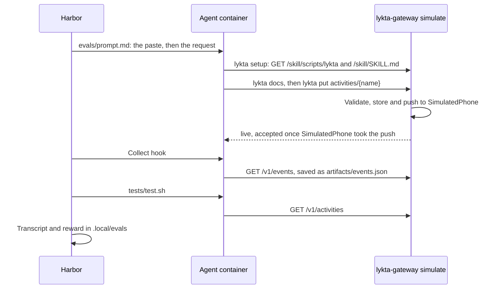

# Evals

`evals` shows what a fresh coding agent does with Lykta when all it has is
what a user gives it: the app's Copy Agent Setup paste and one request. Each
trial runs a stock Claude Code or Codex in a sandbox with its own gateway, and
Harbor keeps the transcript. Afterwards one binary check asks the trial's
gateway whether the agent did the one thing the request needs.

## Run it

It needs Docker and [Harbor](https://github.com/harbor-framework/harbor),
installed with `uv tool install --python 3.13 harbor`.

```bash
just evals
just evals --include-task-name train --n-attempts 4
just evals --agent claude-code --model claude-sonnet-5-5 --ak reasoning_effort=high
harbor view .local/evals
```

`just evals` runs the agents in `evals/job.yaml` twice on every task: Codex
with GPT-6.1 Terra at extra high effort and Claude Code with Claude Opus 5.5 at
high effort, 20 trials at once. The checks are smoke tests of whether a fresh
agent sets up and sends what was asked, not of how good the result looks, so
Terra, a little less capable than GPT-6.1 Sol, is enough. Options after it override the job;
`--model` takes effect only with `--agent`, which replaces the job's agents
and their efforts.

A trial scores 1 when its check passes and 0 when it fails, so the Mean that
Harbor prints is the pass rate.

## Metrics

Judge a change by what agents write and how often they call, before what they
read. Output tokens cost GPT-6.1 Sol $10 per million against $0.10 for cached
input, and every tool call resends the context and waits for a model turn, so
a change that adds a page of docs to save one call or a hundred output tokens
is a gain.

Harbor keeps each trial's transcript, token counts, cost and timings, and each
task's collect hook saves the gateway's events as `artifacts/events.json`.
`scripts/eval-metrics` reads those from one or more job directories, and
`just evals` runs it on the job it just finished. It prints a table for each
agent, version and model, with a median row:

- `accepted`: seconds from the start of Harbor's agent phase to the first
  activity or notification the gateway accepted, or `none` when it accepted
  none, as the reminder expects.
- `agent`: seconds the agent phase took, including the harness's startup and
  exit.
- `model calls` (turns) and `tool calls`, counted in the transcript.
- `payload bytes`: largest accepted activity or notification payload in the
  collected events; `413s`: rejected requests with HTTP 413. Missing events or
  no accepted payload leave size unknown; a full 1000-event page leaves the
  rejection count unknown.
- `input` counts every prompt token, `cached` the ones read from the cache and
  `cache writes` the ones written to it; `output` includes `reasoning`. No
  provider reports how the rest of the output splits between text and tool
  calls.

`--json` prints the same with every agent step: its transcript timestamp in
seconds from the start of the agent phase, the gap since the step before, its
tokens and its tool calls. Harnesses stamp steps differently, Claude Code when
a response starts streaming, so a gap spans tool and model time without
separating them. `?` marks a value the job does not record, such as `accepted`
in jobs from before the events were saved, or every transcript measure of a
trial without a transcript.

```bash
scripts/eval-metrics .local/evals/<job> .local/evals/<other job>
scripts/eval-metrics --json .local/evals/<job>
```

Agents take their usual credentials from the environment: `OPENAI_API_KEY` for
Codex and `ANTHROPIC_API_KEY`, or `CLAUDE_CODE_OAUTH_TOKEN` with
`CLAUDE_FORCE_OAUTH=1`, for Claude Code. `OPENAI_BASE_URL` and
`ANTHROPIC_BASE_URL`, with `ANTHROPIC_AUTH_TOKEN` as the proxy's key, send them
to a proxy instead of the vendor's API; name models without a provider prefix,
because Harbor hands a proxy the name as written. Codex tries a Responses
WebSocket first and falls back to HTTP only when the proxy answers 426. To keep
these out of your shell, put them in `~/.config/lykta/evals.env`, which `just
evals` passes to Harbor as `--env-file` when it exists; its values win over the
shell's.

A task is a folder in `evals/tasks`: the request in `instruction.md`, which
may be empty, a time limit and the event collection in `task.toml`,
`environment` linking the shared `evals/environment` and its check in
`tests/test.sh`. Harbor accepts only tests inside the task, so the tasks that
should show something carry the same check, which passes when the phone drew
an activity the agent sent. The reminder's passes when the agent sent nothing
now, tests-done's when the phone received a notification and the agent
started no activity, and chime's when that notification played a sound the
agent made and uploaded.

## Flow



## Decisions

**Harbor runs the agents.** It is the runner for Terminal-Bench, open source,
and runs locally on Docker. Its Claude Code and Codex agents start each trial
from an empty configuration, so the skills, memories and instructions of
whoever runs the evals never reach the agent, and it records every trial in
one format for both. The alternative, a script around `docker run`, would
rebuild that and the viewer.

**The real gateway with a simulated phone, not a mock.** Agents see the
gateway's own validation errors, statuses and events and read the skill the
checkout serves, so a change to either shows up in the next run.
`lykta-gateway simulate` replaces APNs with `SimulatedPhone`, which accepts
every push and a second later reports what the app does when it shows,
updates or ends the activity; it never marks one stale. Without those reports
agents told users the phone had not confirmed the activity yet. A mock server would have to copy the
API and the layout validation and would drift from both.

**The simulated phone has fixed credentials.** Harbor sends every trial the
same prompt, so the token in `evals/prompt.md` cannot change per trial.
`simulate` registers its phone through the invite path with fixed credentials
and keeps its store in memory, so they never enter a real database.

**One gateway per trial.** Each trial is its own Compose project with an agent
container and a gateway container, so trials share no activities or names and
run in parallel. The gateway image is built from the checkout by `just image`
before every run.

**Agents come installed.** When Harbor installed Node and the agent in each
container, setup took about three minutes per trial. The shared image installs
both CLIs once, at the versions its Dockerfile pins, so runs stay comparable;
raising the pins is how a run tries newer agents.

**The container looks like a user's computer.** It has `curl`, which `lykta`
needs, `python3` and a local timezone in both `TZ` and `/etc/localtime`,
because Codex reads the latter. In a UTC container one agent asked which
timezone 17:42 was in and the other assumed UTC. Requests give relative times,
so a run means the same at any hour.

**Docker's default isolation, for now.** The agent has root and the open
internet, and only Harbor's log directories for the trial are mounted from the
host. Its network shows only the Compose bridge, but the host's and the LAN's
addresses still route, so services there are reachable by IP; SSH on the host
asked for keys. Stricter isolation, such
as Docker Sandboxes, waits until a transcript shows an agent wandering there.

**Binary checks from the gateway.** A check reads the trial's gateway, which
knows what the agent sent and what the phone drew, rather than the transcript,
which says what the agent claims. It passes or fails, without judging how the
activity looks, so a failure means the agent missed the request. An agent
that does nothing, or schedules the activity with something that dies with the
container, also starts nothing now, so the reminder's check passes it; the
transcript shows which. Harbor's `nop` agent, which does nothing, scores 0.2.

## Measured

On an M6 Mac mini with OrbStack on 2026-10-23, 16 trials at once, 8 Codex and
8 Claude Code, both on GPT-6.1 Sol, finished in 75 seconds. Their containers
together peaked at 2.6 GiB and about two cores; a gateway uses about 12 MiB. A
trial took 40,000 to 140,000 input tokens, mostly cached, and 1,000 to 2,000
output tokens. `evals/job.yaml` runs its 20 trials at once; 32 needs about 6
GiB free in Docker's VM.

## Next

- Finer checks from the simulated gateway: every layout the agent sent
  validated, and an activity ended or has `endAfter`.
- Taps: a phone that toggles and presses controls while the agent waits.
- A simulated user who answers when the agent asks a question.
