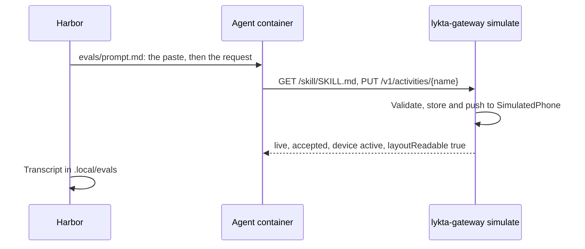

# Evals

`evals` shows what a fresh coding agent does with Lykta when all it has is
what a user gives it: the app's Copy Agent Setup paste and one request. Each
trial runs a stock Claude Code or Codex in a sandbox with its own gateway, and
Harbor keeps the transcript. Nothing is graded yet; reading transcripts comes
first.

## Run it

It needs Docker and [Harbor](https://github.com/harbor-framework/harbor),
installed with `uv tool install --python 3.13 harbor`.

```bash
just evals --agent codex --model gpt-6.1-sol
just evals --agent claude-code --model claude-opus-5-5 --n-attempts 4
just evals --agent codex --model gpt-6.1-sol --include-task-name train
harbor view .local/evals
```

Agents take their usual credentials from the environment or from
`--env-file`: `OPENAI_API_KEY`, `ANTHROPIC_API_KEY`, or
`CLAUDE_CODE_OAUTH_TOKEN` with `CLAUDE_FORCE_OAUTH=1`. `OPENAI_BASE_URL` and
`ANTHROPIC_BASE_URL` point them at a proxy instead of the vendor's API. Codex
uses a proxy without Responses WebSockets only through a custom provider with
`supports_websockets = false`, passed as `--ak config=codex.toml`.

A task is a folder in `evals/tasks`: the request in `instruction.md`, which
may be empty, a time limit in `task.toml`, and `environment` linking the shared
`evals/environment`.

## Flow



## Decisions

**Harbor runs the agents.** It is the runner for Terminal-Bench, open source,
and runs locally on Docker. Its Claude Code and Codex agents start each trial
from an empty configuration, so the skills, memories and instructions of
whoever runs the evals never reach the agent, and it records every trial in
one format for both. The alternative, a script around `docker run`, would
rebuild that and the viewer.

**The real gateway with a simulated phone, not a mock.** Agents see the
gateway's own validation errors, statuses and events and read the skill the
checkout serves, so a change to either shows up in the next run.
`lykta-gateway simulate` replaces APNs with `SimulatedPhone`, which accepts
every push and a second later reports what the app does when it shows,
updates or ends the activity; it never marks one stale. Without those reports
agents told users the phone had not confirmed the activity yet. A mock server would have to copy the
API and the layout validation and would drift from both.

**The simulated phone has fixed credentials.** Harbor sends every trial the
same prompt, so the token in `evals/prompt.md` cannot change per trial.
`simulate` registers its phone through the invite path with fixed credentials
and keeps its store in memory, so they never enter a real database.

**One gateway per trial.** Each trial is its own Compose project with an agent
container and a gateway container, so trials share no activities or names and
run in parallel. The gateway image is built from the checkout by `just image`
before every run.

**Agents come installed.** When Harbor installed Node and the agent in each
container, setup took about three minutes per trial. The shared image installs
both CLIs once, at the versions its Dockerfile pins, so runs stay comparable;
raising the pins is how a run tries newer agents.

**The container looks like a user's computer.** It has `curl`, `python3` and a
local timezone in both `TZ` and `/etc/localtime`, because Codex reads the
latter. In a UTC container one agent asked which timezone 17:42 was in and the
other assumed UTC. Requests give relative times, so a run means the same at
any hour.

**Docker's default isolation, for now.** The agent has root and the open
internet, and only Harbor's log directories for the trial are mounted from the
host. Its network shows only the Compose bridge, but the host's and the LAN's
addresses still route, so services there are reachable by IP; SSH on the host
asked for keys. Stricter isolation, such
as Docker Sandboxes, waits until a transcript shows an agent wandering there.

**No grading yet.** The first runs are for reading what agents do. Grades
come once the transcripts show what is worth checking.

## Measured

On an M6 Mac mini with OrbStack on 2026-10-23, 16 trials at once, 8 Codex and
8 Claude Code, both on GPT-6.1 Sol, finished in 75 seconds. Their containers
together peaked at 2.6 GiB and about two cores; a gateway uses about 12 MiB. A
trial took 40,000 to 140,000 input tokens, mostly cached, and 1,000 to 2,000
output tokens. `just evals` runs 16 trials at once; 32 needs about 6 GiB free
in Docker's VM.

## Next

- Grade from the simulated gateway: every layout the agent sent validated, an
  activity ended or has `endAfter`, and the reminder started none.
- Taps: a phone that toggles and presses controls while the agent waits.
- A simulated user who answers when the agent asks a question.
